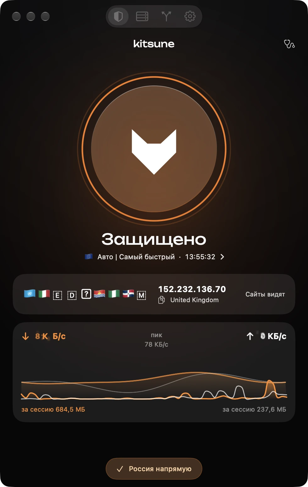
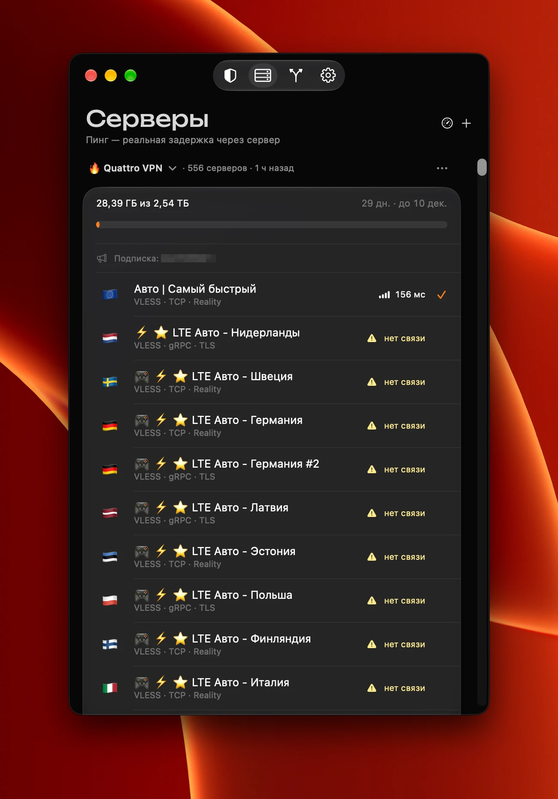
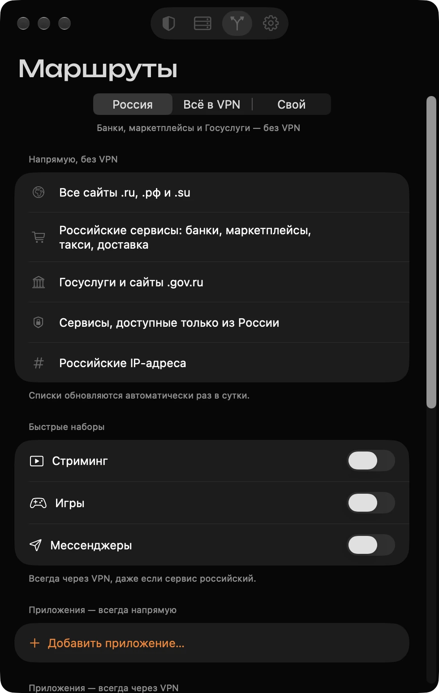
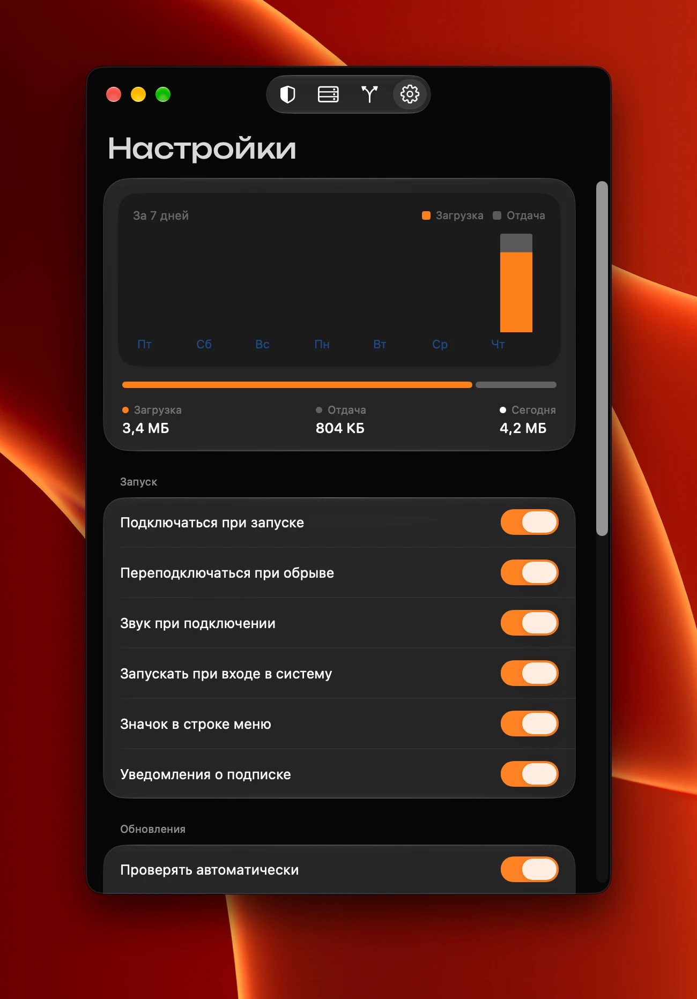

<div align="center">

# 🦊 Kitsune

**VPN, который не мешает.**
Российские сайты открываются напрямую, всё остальное идёт через защищённый туннель.

[](https://github.com/c3RlcHVuaw/Kitsune-/releases/latest/download/Kitsune-mac.dmg)
[](https://github.com/c3RlcHVuaw/Kitsune-/releases/latest/download/Kitsune-mac.zip)
[](https://github.com/c3RlcHVuaw/Kitsune-/releases)




</div>

## Возможности

- **VLESS + Reality и Hysteria2** на ядре [sing-box](https://github.com/SagerNet/sing-box).
- **«Россия напрямую»**: банки, маркетплейсы, Госуслуги, домены .ru, .рф, .su и российские IP идут без VPN. Списки обновляются раз в сутки.
- **Подписки и серверы**: импорт ссылкой, из буфера, QR-кода или файла; автообновление, остаток трафика и срок подписки, пинг до каждого сервера.
- **Правила для приложений**: выбранные программы всегда напрямую или всегда через VPN.
- **Быстрые наборы**: стриминг, игры, мессенджеры принудительно через VPN.
- **Автопереподключение** при обрыве, запуск при входе в систему, значок в строке меню, уведомления об окончании подписки.
- **Живой график скорости** на главном экране: загрузка и отдача за последнюю минуту.
- **Статистика трафика** за неделю и **история подключений** с длительностью и объёмом. Хранится только на устройстве.
- **Приложение через свой сервер**: например, один браузер через Нидерланды, остальное через основной.
- Сортировка серверов по пингу и стране, проверка утечек (IP и DNS), экспорт и импорт настроек, горячая клавиша ⌥⌘K, проверка обновлений через GitHub.
- **Проверка после подключения** (IP сменился, DNS чистый), **пинг сервера по часам**, **раздача VPN по локальной сети** с паролем для ТВ и консолей, значки достижений.
- **Кнопки подписки**: поддержка, сайт и Telegram провайдера, поиск по серверам, сезонное оформление кнопки.
- Нативный интерфейс на **Liquid Glass**, русский и английский язык.
- Никакой телеметрии: Kitsune не видит, какие сайты вы открываете.

## Скриншоты

<table>
  <tr>
    <td align="center"><br><sub>Серверы и подписка</sub></td>
    <td align="center"><br><sub>Маршруты</sub></td>
  </tr>
  <tr>
    <td align="center"><br><sub>Настройки и статистика</sub></td>
    <td></td>
  </tr>
</table>

## Установка на Mac

Приложение не подписано сертификатом Apple, поэтому macOS при первом запуске его блокирует.

1. [Скачайте .dmg](https://github.com/c3RlcHVuaw/Kitsune-/releases/latest/download/Kitsune-mac.dmg) и перетащите Kitsune в «Программы».
2. Снимите карантин одной командой в Терминале:

   ```bash
   xattr -dr com.apple.quarantine /Applications/Kitsune.app
   ```
3. Откройте Kitsune, вставьте ссылку на сервер или подписку.

При первом подключении macOS один раз попросит пароль администратора: он нужен, чтобы создать туннель. Kitsune его не видит и не хранит. Позже разрешение можно отозвать в «Настройки → Доступ».

## Сборка из исходников

Нужны Xcode 26+, [XcodeGen](https://github.com/yonaskolb/XcodeGen) и Libbox.xcframework (собирается `scripts/build-libbox.sh`, в репозиторий не входит из-за размера).

```bash
xcodegen generate
scripts/build-mac.sh      # dist/Kitsune-mac.zip и .dmg
```

Общий код (разбор ссылок, конфиг sing-box, маршруты) лежит в `Shared/` и покрыт тестами:

```bash
cd Shared && swift test
```

## Статус

macOS работает. Версия для iPhone собирается, но подпись и установка через сторонние инструменты не отлажены, поэтому готовых сборок для iOS пока нет. Kill switch (блокировка трафика при падении туннеля) в планах.
